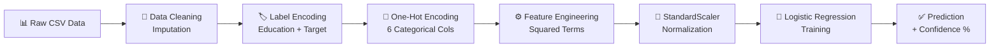

<div align="center">


<br/>

[](https://python.org)
[](https://streamlit.io)
[](https://scikit-learn.org)
[](https://jupyter.org)
[](LICENSE)
[]()

<br/>

> **"Predict loan approvals instantly with the power of Machine Learning"**

<br/>

</div>

---

## 🌟 What is CreditWise?

**CreditWise** is an end-to-end Machine Learning project that predicts whether a loan application should be **Approved ✅** or **Rejected ❌** — based on an applicant's financial, personal, and credit-related profile.

It features a full ML pipeline from raw data to a live **Streamlit web app** with a premium dark-themed UI, making it production-ready and visually stunning.

---

## ✨ Live Demo

> Run the app locally with one command:

```bash
streamlit run app.py
```

Then open 👉 **http://localhost:8501**

---

## 🖥️ App Preview

<div align="center">

| 🏠 Input Form | ✅ Approved Result | ❌ Rejected Result |
|:-:|:-:|:-:|
| Dark glassmorphism UI | Green result card | Red result card |
| 3 organized sections | Confidence % shown | Confidence % shown |
| Real-time prediction | Key metric tiles | Key metric tiles |

</div>

---

## 🗂️ Project Structure

```
📦 Credit-Wise-Loan-Approval
├── 📓 credit_wise.ipynb        ← Full ML pipeline notebook
├── 🌐 app.py                   ← Streamlit web application
├── 🐍 generate_pickle.py       ← Script to regenerate pickle files
├── 📊 loan_approval_data.csv   ← Training dataset (1000 records)
├── 🤖 model.pkl                ← Trained Logistic Regression model
├── ⚖️  scaler.pkl               ← Fitted StandardScaler
├── 🏷️  label_encoder.pkl        ← Fitted LabelEncoder
├── 🔢 ohe_encoder.pkl          ← Fitted OneHotEncoder
├── 📋 feature_columns.pkl      ← Ordered feature column names
└── 📄 README.md
```

---

## 🔬 ML Pipeline — Step by Step



---

## 🤖 Models Trained & Compared

<div align="center">

| Model | Accuracy | Precision | Recall | F1 Score |
|:------|:--------:|:---------:|:------:|:--------:|
| 🏆 **Logistic Regression** | **87.50%** | **79.03%** | **80.33%** | **79.67%** |
| 🔵 K-Nearest Neighbors | ~84% | ~76% | ~77% | ~76% |
| 🟡 Gaussian Naive Bayes | ~82% | ~74% | ~75% | ~74% |

> ✅ **Logistic Regression** was selected as the final model for deployment.

</div>

---

## ⚙️ Feature Engineering

The model uses **27 features** after preprocessing:

| Category | Features |
|----------|----------|
| 💰 Financial | `Applicant_Income`, `Coapplicant_Income`, `Savings`, `Collateral_Value` |
| 🏦 Loan Details | `Loan_Amount`, `Loan_Term`, `Existing_Loans` |
| 👤 Personal | `Age`, `Dependents`, `Education_Level` |
| 📐 Engineered | `DTI_Ratio_sq`, `Credit_Score_sq` |
| 🔢 One-Hot | `Marital_Status`, `Employment_Status`, `Loan_Purpose`, `Gender`, `Employer_Category`, `Property_Area` |

---

## 🚀 Quick Start

### 1️⃣ Clone the Repository

```bash
git clone https://github.com/BKathalewar/Credit-Wise-Loan-Approval.git
cd Credit-Wise-Loan-Approval
```

### 2️⃣ Install Dependencies

```bash
pip install pandas numpy scikit-learn matplotlib seaborn streamlit
```

### 3️⃣ (Optional) Regenerate Pickle Files

```bash
python generate_pickle.py
```

### 4️⃣ Run the Streamlit App

```bash
streamlit run app.py
```

---

## 📥 Input Features

<details>
<summary><b>👤 Personal Information</b></summary>

| Field | Type | Description |
|-------|------|-------------|
| Age | Numeric | Applicant's age (18–80) |
| Gender | Categorical | Male / Female |
| Marital Status | Categorical | Married / Single |
| Dependents | Numeric | Number of dependents |
| Education Level | Categorical | Graduate / Not Graduate |
| Property Area | Categorical | Rural / Semiurban / Urban |

</details>

<details>
<summary><b>💼 Employment & Income</b></summary>

| Field | Type | Description |
|-------|------|-------------|
| Employment Status | Categorical | Salaried / Self-employed / Contract / Unemployed |
| Employer Category | Categorical | Private / Government / MNC / Business / Unemployed |
| Applicant Income | Numeric | Monthly income of applicant |
| Co-applicant Income | Numeric | Monthly income of co-applicant |
| Savings | Numeric | Total savings amount |

</details>

<details>
<summary><b>🏦 Loan Details</b></summary>

| Field | Type | Description |
|-------|------|-------------|
| Loan Purpose | Categorical | Home / Car / Education / Business / Personal |
| Loan Amount | Numeric | Requested loan amount |
| Loan Term | Numeric | Loan duration in months |
| Credit Score | Numeric | Credit score (300–900) |
| DTI Ratio | Numeric | Debt-to-Income ratio (0.0–1.0) |
| Collateral Value | Numeric | Value of collateral provided |
| Existing Loans | Numeric | Number of existing loans |

</details>

---

## 💡 Tips for Loan Approval

> These values typically result in an **Approved** prediction:

| Factor | Ideal Value |
|--------|------------|
| 🎯 Credit Score | ≥ 700 |
| 📉 DTI Ratio | ≤ 0.30 |
| 🎓 Education | Graduate |
| 💼 Employment | Salaried |
| 💰 Income | Stable & above average |
| 🏠 Property Area | Urban |

---

## 🛠️ Tech Stack

<div align="center">


</div>

---

## 👨‍💻 Author

<div align="center">

**Bhargav Kathalewar**

[](https://github.com/BKathalewar)

</div>

---

<div align="center">


⭐ **If you found this project useful, please give it a star!** ⭐

</div>
